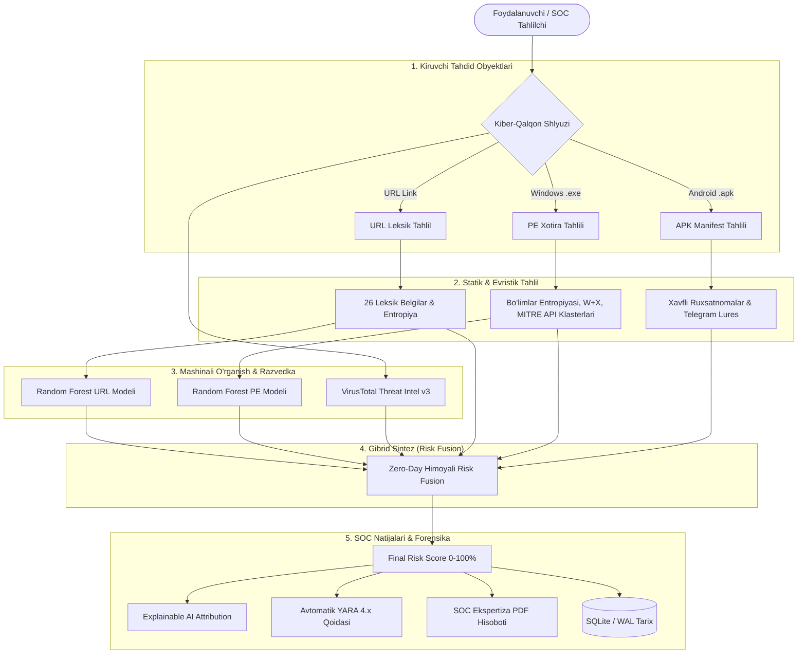

<div align="center">

# 🛡️ PhishGuard AI

### Multi-Layer Cyber Threat Detection & SOC Forensic Analysis Platform
*(Ko'p Pog'onali Kiberxavfsizlik va Tahdidlarni Tahlil Qilish Platformasi)*

[](https://phishguard-soc.netlify.app)
[](https://www.python.org/)
[](https://fastapi.tiangolo.com/)
[](https://scikit-learn.org/)
[](https://www.docker.com/)
[](LICENSE)

<br/>

**[🌐 Jonli Veb-Ilova (Live Demo)](https://phishguard-soc.netlify.app)** • **[📖 API Hujjatlari (Swagger)](http://127.0.0.1:8000/docs)** • **[📦 Chrome Extension](#-browser-extension-chrome-mv3)** • **[🤖 Telegram SOC Bot](#-telegram-soc-bot)**

</div>

---

## 📌 Loyiha Haqida (Project Overview)

**PhishGuard AI** — shubhali veb-havolalar (**Phishing URLs**), Windows ijro fayllari (**PE/EXE Malware**) hamda Android mobil ilovalari (**APK Trojans**) xavfini chuqur statik tahlil, mashinali o'rganish (**Random Forest & XGBoost ML**) va global tahdid razvedkasi (**VirusTotal API v3**) sintezi orqali aniqlovchi intellektual kiberxavfsizlik platformasi.

Tizim fayllarni kompyuterda ochmasdan yoki ishga tushirmasdan (**Pure In-Memory Static Analysis**), bir nechta mustaqil tahlil qatlamlarini yagona va tushunarli **Risk Score (0–100%)** ko'rsatkichiga birlashtiradi.

---

## ✨ Asosiy Imkoniyatlar (Key Features)

| Qatlam | Modul | Vazifasi & Imkoniyatlari |
| :--- | :--- | :--- |
| 🌐 **URL Scanner** | `url_features.py` + `ml_url_model.py` | 26 ta leksik belgi (Shannon entropiyasi, IP-xostlar, gomoglif/punycode, shubhali TLDlar) + Random Forest modeli (133k+ dataset). |
| 🖥️ **EXE Scanner** | `exe_analyzer.py` + `ml_exe_model.py` | Windows PE formatini xotirada tahlil qilish: bo'limlar entropiyasi, **W+X (Write+Execute)** xavfli xotira huquqlari, TLS Callbacks, pakerlar (UPX/Themida), Win32 API klasterlari. |
| 📱 **APK Scanner** | `apk_analyzer.py` | `AndroidManifest.xml` tahlili, xavfli ruxsatlar kombinatsiyasi (`SYSTEM_ALERT_WINDOW` + `ACCESSIBILITY`), SMS/OTP o'g'irlash hamda O'zbekistonga xos aldov so'zlari (*"to'y"*, *"jarima"*, *"soliq"*). |
| ⚖️ **Risk Fusion** | `risk_fusion.py` | Evristik qoidalar, ML ehtimolligi va VirusTotal natijalarini konsensus kuchi bo'yicha birlashtirish. **Zero-Day paradoksi** yechimi. |
| 💡 **Explainable AI (XAI)** | `xai_explainer.py` | Model qarorining qora quti (black-box) bo'lib qolmasligi uchun har bir belgining xavfga qo'shgan foiz hissasini (Feature Attribution) ko'rsatish. |
| 📜 **YARA Generator** | `services/yara_generator.py` | Skanerlangan tahdidlar uchun **MITRE ATT&CK** taktikalari bilan boyitilgan avtomatlashtirilgan **YARA 4.x** qoidalarini shakllantirish. |
| 🏢 **Brand Radar** | `services/brand_radar.py` | Payme, Click, Uzum, Hamkorbank, NBU kabi milliy to'lov tizimlari va banklarning klon/typosquatting domenlarini aniqlash. |
| 📄 **SOC PDF Generator**| `pdf_report_generator.py` | Tashqi kutubxonalarga bog'lanmagan (Zero-dependency) toza Python orqali rasmiy forensik ekspertiza xulosasini PDF 1.4 formatida eksport qilish. |
| 🗺️ **Threat Map** | `services/geolocator.py` | Global va O'zbekiston hududiy kiber-hujumlar traektoriyalari real vaqt telemetriyasi. |
| 🛡️ **Enterprise Security**| `auth.py` + `rate_limit.py` | Role-Based Access Control (**RBAC: ADMIN/ANALYST/VIEWER**) hamda Redis-ready taqsimlangan Rate Limiting (In-Memory fallback bilan). |

---

## 🏛️ Tizim Arxitekturasi (System Architecture)



---

## 🔬 Zero-Day Paradoksi Yechimi (Novel Threat Defense)

Standart tizimlarda agar yangi (Zero-Day) virus hali antivirus bazalarida ro'yxatga olinmagan bo'lsa, VirusTotal `0/70` natija qaytaradi va tizim uni xatolik bilan *"Xavfsiz"* deb baholaydi. 

PhishGuard AI ushbu muammoni dinamik konsensus orqali hal qiladi:
* Agar lokal evristika va AI jiddiy anomaliyalarni (masalan, yuqori entropiya + W+X xotira huquqlari + shubhali API funksiyalari) aniqlasa (`local_score >= 60`), tashqi bazada hali topilmaganligiga qaramasdan **lokal tahlilga 80% ustunlik (`local_weight = 0.8`)** beriladi.
* Natijada yangi va kataloglashtirilmagan tahdidlar o'tkazib yuborilmaydi.

---

## 📊 Mashinali O'rganish Metrikalari (Benchmark)

URL modelini o'rgatish uchun 133 090 ta muvozanatli (balanced) namunadan iborat ma'lumotlar to'plami va **RandomizedSearchCV (5-Fold Cross-Validation)** qo'llanilgan:

| Model / Algoritm | Accuracy | Precision | Recall | F1-Score |
| :--- | :---: | :---: | :---: | :---: |
| **Random Forest (O'rgatilgan)** | **88.0%** | **88.4%** | **87.7%** | **88.0%** |
| XGBoost (Gradient Boosting) | 87.2% | 87.9% | 86.5% | 87.1% |
| Decision Tree (Baseline) | 82.4% | 81.9% | 83.1% | 82.5% |

---

## 🚀 O'rnatish va Ishga Tushirish (Quickstart)

### 1-usul: Mahalliy Kompyuterda (Local Python)

```bash
# 1. Ombor nusxasini oling (Clone)
git clone https://github.com/your-username/Phishguard-ai.git
cd Phishguard-ai/backend

# 2. Virtual muhitni yoqing
python -m venv venv
# Windows:
.\venv\Scripts\activate
# Linux/macOS:
source venv/bin/activate

# 3. Kutubxonalarni o'rnating
pip install -r requirements.txt

# 4. Konfiguratsiya faylini tayyorlang
cp .env.example .env

# 5. Serverni ishga tushiring
uvicorn main:app --reload --port 8000
```
Brauzerda oching: 👉 **`http://127.0.0.1:8000/`** (Frontend va Backend bitta portda ishlaydi).

---

### 2-usul: Docker & Docker Compose

```bash
docker compose up --build
```
Brauzerda oching: 👉 **`http://localhost:8000/`**

---

## 🧩 Browser Extension (Chrome MV3)

PhishGuard AI real vaqt rejimida har bir ochilgan veb-sahifani brauzer darajasida tekshiruvchi **Manifest V3 kengaytmasiga** ega:

1. Google Chrome brauzerida `chrome://extensions/` manzilini oching.
2. Yuqori o'ng burchakdagi **"Developer mode"** kalitini yoqing.
3. **"Load unpacked"** tugmasini bosing va loyihadagi `extension` papkasini tanlang.
4. Kengaytma har bir yangi kirilgan saytni xavfsizlik darajasini avtomatik tahlil qiladi va xavfli saytlarni bloklaydi.

---

## 🤖 Telegram SOC Bot

Smartfon orqali shubhali havolalar yoki fayllarni tezkor tekshirish uchun:
```bash
cd backend
python telegram_bot.py
```
*(Foydalanishdan oldin `.env` faylida `TELEGRAM_BOT_TOKEN` ni ko'rsating).*

---

## 📡 REST API Yo'riqnomasi

Interaktiv Swagger UI hujjatlari: `http://127.0.0.1:8000/docs`

| HTTP Metod | Endpoint | Vazifasi |
| :--- | :--- | :--- |
| `GET` | `/api/health` | Tizim salomatligini tekshirish |
| `POST` | `/api/analyze` | Veb-havolani (URL) to'liq tahlil qilish |
| `POST` | `/api/analyze-exe` | Windows PE (.exe) ijro faylini xotirada tahlil qilish |
| `POST` | `/api/analyze-apk` | Android ilovasini (.apk) chuqur tahlil qilish |
| `POST` | `/api/analyze-behavioral`| Dinamik xatti-harakatlar (Sandbox profile) tahlili |
| `POST` | `/api/yara/generate` | Skanerlangan obyekt uchun YARA 4.x qoidasini yaratish |
| `POST` | `/api/export-pdf` | Rasmiy SOC ekspertiza xulosasini PDF shaklida yuklab olish |
| `GET` | `/api/brand-radar/presets` | O'zbekistonning mashhur brendlari monitoring ro'yxati |
| `GET` | `/api/system/status` | Tizim telemetriyasi, Redis va RBAC autentifikatsiya holati |
| `GET` | `/api/scan-history` | Qidiruv va filtrli tekshiruvlar tarixi |
| `GET` | `/api/dashboard` | Statistik ma'lumotlar va xavf darajalari nisbati |

---

## 🧪 Sinovlar (Automated Testing)

Barcha modullarning integratsiyasi va xavfsizlik qoidalarini avtomatlashtirilgan tarzda tekshirish:
```bash
python backend/test_integration.py
```

---

## 📄 Litsenziya

Ushbu loyiha [MIT License](LICENSE) asosida ochiq manbali tarzda tarqatiladi.

---

<div align="center">
  <b>Developed for Cyber Threat Intelligence & Modern Defense Operations</b><br/>
  ⭐ Agar loyiha sizga ma'qul kelgan bo'lsa, GitHub'da Star bosishni unutmang!
</div>
